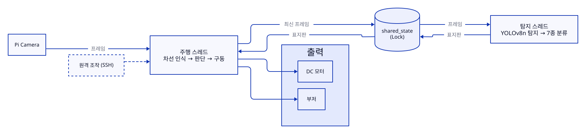

# PI-LOT

라즈베리파이와 카메라 한 대로 차선을 따라 달리고, 표지판을 인식해 교차로·정지·감속에
대응하는 소형 자율주행 차량입니다.

- 제4회 매치업(Match業) 심화과정 경진대회 실무보고서 부문 **우수상**, 포스터 부문 **장려상** (2025-12-05)
- 2025년 2학기 임베디드 AI 시스템 최적화 과목 프로젝트

<!-- 데모 GIF -->

## 주요 기능

| 상황 | 동작 |
|------|------|
| 차선 유지 | 좌우 차선의 픽셀 수 균형으로 조향합니다 |
| 교차로 | 멈춘 뒤 미리 인식해 둔 방향 표지판대로 직진·좌회전·우회전합니다 |
| 정지 표지판 | 2초 정지한 뒤 천천히 재출발합니다 |
| 감속 표지판 | 3초 동안 감속합니다 |
| 경적 표지판 | 부저로 학교종 멜로디를 냅니다 |
| 신호등 | 교차로에서 잠시 정지한 뒤 통과합니다 |
| 파란 정지선 | 첫 번째는 통과하고 두 번째에서 주행을 마칩니다 |

## 구조



주행 스레드는 프레임마다 차선을 측정하고 조향을 정해 모터를 구동합니다. YOLO 추론은
별도 스레드에서 실행해 추론 중에도 조향 주기를 유지하고, 두 스레드는 Lock으로 보호한
공유 상태로 프레임과 인식 결과를 주고받습니다.

자세한 구조는 [docs/architecture.md](docs/architecture.md), 설계 결정은
[docs/adr/](docs/adr/)에 있습니다.

## 표지판 인식

탐지 모델(YOLOv8n)이 표지판과 신호등 영역을 찾고, 분류 모델(YOLOv8n-cls)이 잘라낸
영역을 7종(직진·좌회전·우회전·정지·감속·경적·신호등)으로 분류하는 2단계 구조입니다.
단계마다 신뢰도 임계값(탐지 0.8, 분류 0.9)을 따로 두어 오인식을 두 번 거릅니다.

분류 모델의 학습 데이터는 1,274장에서 4,394장(클래스당 약 600장)으로 늘리고 증강을
더해 학습했습니다.

| 탐지 모델 | 학습일 | mAP50 | mAP50-95 |
|-----------|--------|-------|----------|
| V1 | 2025-11-01 | 0.985 | 0.754 |
| **V3 (시연)** | 2025-12-02 | **0.994** | **0.919** |

데이터와 학습 설정은 [docs/model-card.md](docs/model-card.md)에 있습니다.

## 담당

팀 PI-LOT(4명)는 차량 2대로 두 명씩 나눠 개발했고, 이 저장소는 시연 차량의 코드입니다.

| 담당 | 범위 |
|------|------|
| junsu | 차선 유지 주행 로직 (`lane_tracer.py` 주요 구현) |
| keonha | 표지판 인식 (`object_detector.py`, YOLO 모델 학습·데이터 수집), 주행·추론 스레드 분리, 파란색 정지선 2단계 종료 판정, 주행 파라미터 튜닝 |

## 실행

라즈베리파이에서 동작합니다. GPIO와 Picamera2를 사용합니다.

```bash
pip install picamera2 opencv-python numpy gpiozero ultralytics
python main.py
```

YOLO 가중치 두 개는 용량 때문에 저장소에 포함하지 않았습니다. 코드는 저장소 폴더의
상위 디렉터리에서 `models/`를 찾습니다.

```
<상위 폴더>/
├── models/
│   ├── sign_traffic_detectorV3.pt     # 표지판 영역 탐지
│   └── sign_traffic_classifierV3.pt   # 7종 분류
└── <이 저장소>/
```

Ctrl+C로 종료하면 두 스레드에 종료를 알리고 기다린 뒤 모터를 정지시킵니다.

`tools/`에는 주행과 별개로 실행하는 개발 도구가 있습니다.

| 파일 | 용도 |
|------|------|
| `tools/key_remote.py` | SSH 접속 상태에서 키보드로 수동 조종 |
| `tools/collect_object_data.py` | 수동 주행 중 주기적으로 캡처해 표지판 학습 데이터 수집. 과목에서 제공한 `mycamera` 모듈을 같은 폴더에 두고 실행합니다 |

부품과 핀 배치는 [docs/hardware.md](docs/hardware.md)에 있습니다.

## 문서

| 문서 | 내용 |
|------|------|
| [architecture.md](docs/architecture.md) | 모듈 구성, 스레드와 공유 상태, 주행 흐름 |
| [adr/](docs/adr/) | 주요 설계 결정과 이유 |
| [model-card.md](docs/model-card.md) | 표지판 인식 모델의 데이터, 학습, 성능 |
| [hardware.md](docs/hardware.md) | 부품과 핀 배치 |
