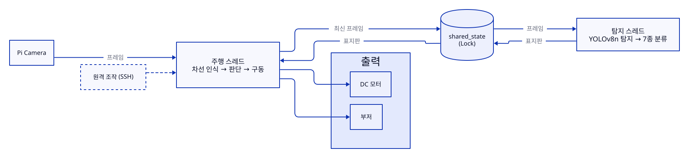
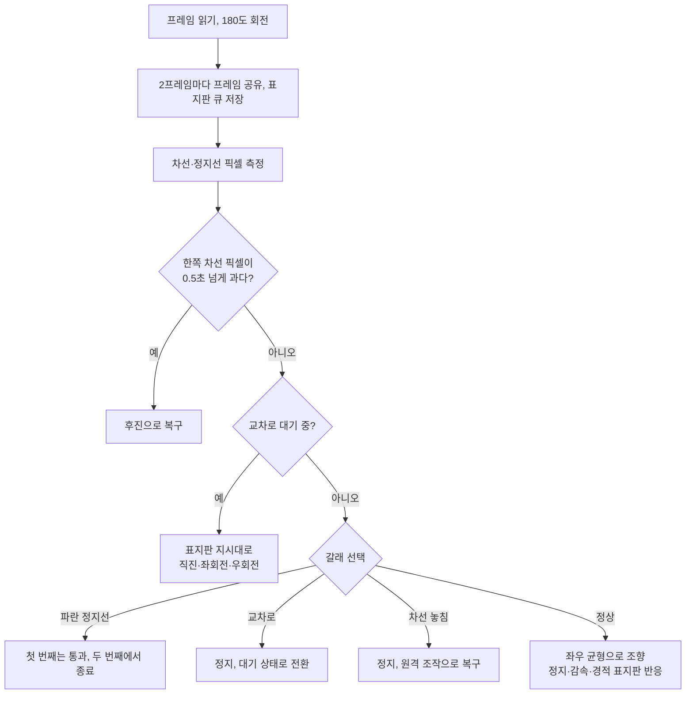
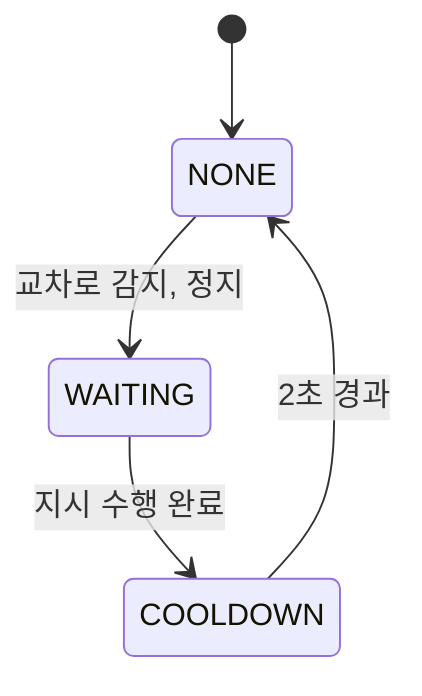

# 구조

## 모듈

| 파일 | 역할 |
|------|------|
| `main.py` | 진입점. 하드웨어를 열고 두 스레드를 시작·종료합니다 |
| `lane_tracer.py` | 주행 루프. 프레임마다 측정 → 판단 → 구동을 반복하고 표지판 대응 동작을 수행합니다 |
| `vision.py` | Sense. 프레임 한 장을 픽셀 수 몇 개로 줄입니다 |
| `control.py` | Plan. 조향, 교차로 상태, 정지선 판정, 동작 순서표, 속도 프로파일. 부작용이 없는 함수로 되어 있습니다 |
| `hardware.py` | Act. 모터·부저·카메라 드라이버 |
| `object_detector.py` | 탐지 스레드. YOLOv8 탐지 → 분류 |
| `shared_state.py` | 두 스레드가 공유하는 상태와 Lock |
| `config.py` | 주행 파라미터와 핀 번호. 트랙에서 조정한 값이 모여 있습니다 |
| `tools/` | 개발 도구 (키보드 수동 조종, 표지판 데이터 수집) |

## 스레드와 공유 상태

`main.py`가 주행 스레드와 탐지 스레드를 시작합니다. Ctrl+C를 받으면 종료 이벤트로 두
스레드에 알리고, 끝나기를 기다린 뒤 모터를 정지시킵니다.

두 스레드는 Lock으로 보호한 `shared_state`로 데이터를 주고받습니다.

| 필드 | 쓰는 쪽 | 읽는 쪽 | 내용 |
|------|---------|---------|------|
| `latest_frame` | 주행 | 탐지 | 2프레임마다 올리는 최신 프레임 |
| `object_state` | 탐지 (주행 스레드는 반응한 뒤 False로 되돌림) | 주행 | 클래스별 감지 여부 |
| `confidence` | 탐지 | 주행 | 클래스별 신뢰도 |
| `action_last_time` | 주행 | 주행 | 동작별 마지막 실행 시각 (쿨다운) |
| `slow_mode_until` | 주행 | 주행 | 감속 종료 시각 |

탐지 스레드는 주기마다 모든 감지 여부를 초기화한 뒤, 표지판 가운데 박스가 가장 큰
하나와 신호등만 올립니다. 그래서 주행 스레드는 한 번에 표지판 하나에만 반응합니다.

탐지 스레드를 따로 둔 이유는 [ADR-0003](adr/0003-detection-thread.md)에 있습니다.

## 한 프레임의 흐름

갈래는 위에서부터 우선합니다. 정지선이 교차로보다, 교차로가 차선 추종보다 앞섭니다
(`control.select_branch`).

| 갈래 | 조건 |
|------|------|
| 파란 정지선 | 화면 하단 25%의 파란 픽셀 25,000 이상 |
| 교차로 | 전방 중앙 박스 픽셀 5,000 초과, 좌우 차선 픽셀 합 1,600 미만 |
| 차선 놓침 | 좌우 차선 픽셀 합 800 미만 |
| 정상 | 그 밖의 경우 |

교차로는 중앙과 좌우를 함께 봅니다. 중앙만 보면 굵은 직선 구간에서도 걸리고, 좌우만
보면 차선 이탈과 구분되지 않기 때문입니다.

## 교차로 상태

| 상태 | 의미 |
|------|------|
| `NONE` | 정상 주행 |
| `WAITING` | 교차로에서 멈춰 큐에 저장된 표지판 지시를 수행합니다. 표지판이 없으면 원격 조작 입력을 받고, 3초가 지나면 직진합니다 |
| `COOLDOWN` | 방금 지나온 교차로를 다시 잡지 않도록 정지선·교차로 감지를 2초간 억제합니다 |

회전은 (동작, 시간) 순서표대로 수행합니다. 좌회전을 예로 들면 4초 직진, 5초 회전,
0.8초 직진입니다.

## 표지판 반응

| 표지판 | 처리 | 동작 |
|--------|------|------|
| 직진·좌·우·신호등 | 큐에 쌓았다가 교차로에서 | [ADR-0004](adr/0004-sign-queue.md) |
| 정지 | 주행 중 즉시 | 2초 정지, 0.5초 저속 재출발 |
| 감속 | 주행 중 즉시 | 3초 동안 감속 속도로 주행 |
| 경적 | 주행 중 즉시 | 학교종 멜로디 |

정지와 경적은 한 번 반응하면 4초 동안 다시 반응하지 않습니다.
