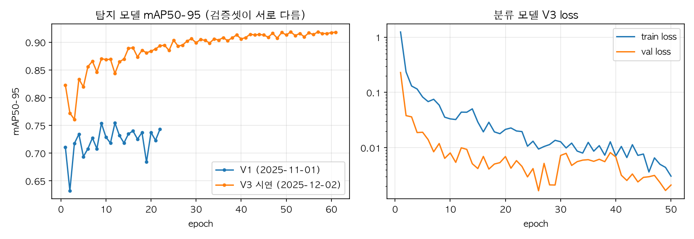

# 모델 카드: 표지판 인식

## 개요

탐지 모델과 분류 모델을 이어 쓰는 2단계 구조입니다
([ADR-0002](adr/0002-two-stage-sign-recognition.md)).

| | 탐지 | 분류 |
|---|---|---|
| 파일 | `sign_traffic_detectorV3.pt` | `sign_traffic_classifierV3.pt` |
| 구조 | YOLOv8n | YOLOv8n-cls |
| 입력 크기 | 640px | 224px |
| 클래스 | `sign`, `traffic` (2종) | `go_straight`, `turn_left`, `turn_right`, `stop`, `slow`, `horn`, `traffic_light` (7종) |
| 주행 시 임계값 | 신뢰도 0.8, 박스 면적 10,000px 이상 | 신뢰도 0.9 |

## 데이터

분류 모델은 직접 모은 원본 이미지에 증강을 더해 학습했습니다. 첫 데이터 1,274장에서
4,394장으로 늘렸습니다.

| 클래스 | 원본 |
|--------|------|
| go_straight | 618 |
| turn_left | 683 |
| turn_right | 596 |
| stop | 657 |
| slow | 644 |
| horn | 591 |
| traffic_light | 605 |
| **합계** | **4,394** |

## 학습

Google Colab GPU에서 ultralytics 8.3으로 학습했습니다.

- 탐지 모델: 입력 640px, AdamW(lr 0.001), 최대 80 에폭에 patience 10 조기 종료
  (61 에폭에서 종료, 최고 성능 51 에폭)
- 분류 모델: 입력 224px, 배치 32, 50 에폭

## 성능

| 탐지 모델 | 학습일 | Precision | Recall | mAP50 | mAP50-95 |
|-----------|--------|-----------|--------|-------|----------|
| V1 | 2025-11-01 | 0.972 | 1.000 | 0.985 | 0.754 |
| **V3 (시연)** | 2025-12-02 | **0.996** | **0.998** | **0.994** | **0.919** |

V1에서 V3로 가며 입력 크기를 480px에서 640px로 키우고 옵티마이저를 AdamW로
바꿨습니다. mAP50-95는 0.754에서 0.919로 올랐습니다.

## 주행 환경 튜닝

트랙에서 주행하며 탐지 임계값을 조정했습니다. 신뢰도 기준을 0.7에서 0.8로, 최소 박스
면적을 5,000px에서 10,000px로 올려 신뢰도가 낮거나 멀리 있는 검출을 거르도록 했습니다.
